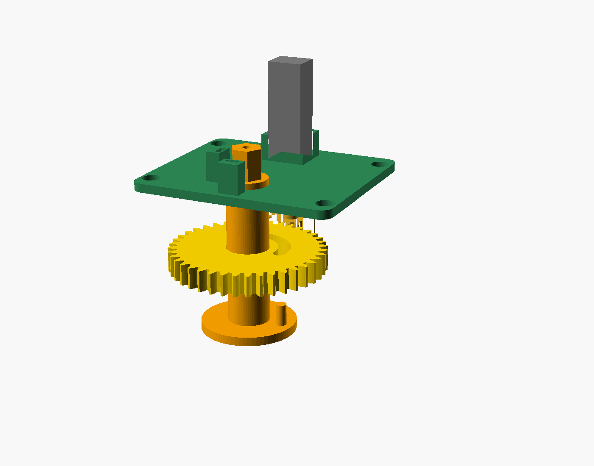

# Phase 2: Mechanical Design (v0)

Status: **first parametric draft**. Every part exports as a clean solid, and the gears were checked for tooth interference across a full mesh cycle. Nothing has been printed yet. Dimensions marked `[UNVERIFIED]` in `mech/params.scad` must be confirmed with the fit-test coupons before the real parts are ordered.



## Files

| File | What it is |
|---|---|
| `mech/params.scad` | **Every dimension lives here.** Edit this file only, then re-export. |
| `mech/parts.scad` | Part modules, modelled in assembly position |
| `mech/fit_tests.scad` | Measurement coupons (print these first) |
| `mech/assembly.scad` | Assembly viewer (`explode`, `show_lid` etc. at the top) |
| `mech/print.scad` | One part laid flat for printing, chosen with `-D part="name"` |
| `mech/export.ps1` | Exports every part to `mech/stl/` |
| `mech/torque_calc.py` | Motor torque and unlock-time check |
| `mech/lib/geom.scad` | Involute gear generator and 2D helpers (no external libraries) |

Open any `.scad` file in OpenSCAD to view it (F5 preview, F6 render). To regenerate the STLs after editing parameters:

```powershell
.\mech\export.ps1
```

## How it works

```
motor (N20 + encoder) -> 12T pinion -> 40T output gear --(lost motion)--> hub -> tailpiece -> bolt
                                                                          ^
                                                          manual knob ----+   (exterior key also turns the tailpiece)
```

**Lost-motion coupling: the key safety feature.** The output gear doesn't grip the hub. A lug on the hub flange rides in a 102° arc slot in the gear, which allows 90° of travel plus 6° of free play at each end.
- To unlock, the motor turns the gear until the slot end picks up the lug and carries it through 90°. The motor then **reverses back to a parked (neutral) position**, where the lug is free across its whole travel.
- While parked, the knob and the exterior key turn the bolt freely and never back-drive the motor. That is how R5 is met without a clutch, and it's why a non-back-drivable gearbox (or a worm drive later) is acceptable.

**One failure mode to handle in firmware:** if power dies *while locking*, the slot end is left on the unlocked side of the lug, which blocks the key from unlocking. Mitigations: refuse to lock below a battery threshold, keep a reserve capacitor to finish parking, and always park immediately after every move. Losing power mid-*unlock* is safe, because the key's unlock direction is free.

**Sensing**
- **Hub (bolt) angle:** a 4 × 8 mm axially magnetised cylinder sits in a cross-hole through the hub, so its field rotates with the hub. Two DRV5055 linear hall sensors 90° apart on the bridge read it as sine and cosine, and `atan2` gives the absolute hub angle. This works for any door orientation after calibration, and it detects manual or key turns.
- **Gear position:** from the N20's built-in hall encoder.
- **Stall:** from motor current (INA219 or the driver's current sense).
- **Calibration at install:** drive slowly to each bolt end until stall, record the encoder counts and hub angles, and compute the park position. On every boot, re-home by pushing gently toward the end the bolt is already at. That gives an encoder reference without moving the bolt.


## Size and layout

- **Footprint:** 81 × 140.5 mm. The spindle is 32 mm from the bottom edge, so the unit extends upward, away from the door handle.
- **Depth:** about 58.6 mm from the door to the top of the lid, plus a 16.5 mm knob. That's **about 75 mm in total**, against roughly 25 mm for the original thumb turn. The depth is set by the motor standing vertically (34 mm with encoder).
- **Battery:** flat 4×AA holder in the upper bay, reached by removing the lid (4 × M3 screws).
- **Electronics** (XIAO nRF52840 Sense, motor driver, current sensor): on the bridge top, beside the motor.

| Z (mm from door) | Layer |
|---|---|
| 0 to 6 | Base floor (pocket underneath clears the door plate) |
| 6.3 to 9.3 | Hub flange with lug |
| 9.8 to 16.8 | Output gear and pinion |
| 17.6 to 20.6 | Bridge (motor mount, upper hub bearing, sensors) |
| 20.6 to 54.6 | Motor; sensors at about 26 |
| 56.1 to 58.6 | Lid |
| 59 to 75 | Knob |

**Slimming path for v1:** because lost motion makes back-driving unnecessary, the motor can lie flat with a worm drive, which would bring the depth to roughly 30–35 mm. Do this after v0 proves the concept.

## Fit tests: measuring without tools

Print in PLA at 0.2 mm layers. They're cheap and small. The first two combs pin down the tailpiece, which is the most important unknown.

| Coupon | Use | Updates |
|---|---|---|
| `fit_tp_width` | Slide the slots over the tailpiece end. Use the tightest one that still slides. | `tp_w` |
| `fit_tp_thick` | Same, for thickness | `tp_t` |
| `fit_screw_gauge` | Place it over the lock with the thumb turn removed and the tailpiece through the centre. Rotate until both screw holes show in the slots, then read the spacing on the scale. Compare the outer edge with the original rose, and the left-hand arcs with the door plate. | `screw_spacing`, `screw_angle`, `door_plate_d` |
| `fit_hub_slot` | After updating `tp_w` and `tp_t`, print this as a final check of the real hub slot fit | `tp_clear` |

Also check with the coupons, or a strip of paper marked with a pen:
- how far the tailpiece sticks out beyond the plate (`tp_slot_depth` assumes 19 mm or less)
- the plate's height (`door_plate_h`)
- the thumb turn's rotation (`travel`)

## Printing the real parts

| Part | Recommended | Why |
|---|---|---|
| `hub`, `out_gear`, `pinion` | MJF / SLS nylon (PA12) from an online service | Strong and wear-resistant. No supports needed, which matters because the hub flange overhangs. |
| `base`, `bridge`, `lid`, `knob` | PETG or ASA, FDM | Cheap. PLA creeps if the door is in the sun. |
| Fit tests | PLA | Throwaway |

## Hardware for the mechanism

| Item | Qty | Notes |
|---|---|---|
| N20 gearmotor **with hall encoder**, 6 V | 1 | Ratio choice: see below |
| Magnet, 4 mm dia × 8 mm, axially magnetised, N52 | 1 | Glued into the hub cross-hole |
| DRV5055 linear hall sensor, TO-92 (LPG) package | 2 | Choose sensitivity after a bench test |
| M3 self-tapping or machine screws, 8–10 mm | about 9 | 4 for the lid, 4 for the bridge, 1 for the knob |
| Flat 4×AA holder (about 62 × 58 mm) | 1 | Check the footprint against `batt_w` and `batt_l` |
| Shorter replacement lock screws | 2 | Possibly. Our base clamps much less material than the original thumb turn, so the original screws may bottom out. Check at fit-test time. |

## Finding: the N20 is marginal

`python mech/torque_calc.py` uses typical listing values, not datasheets:

- At 6 V, only a **1:100 N20 meets both targets** (stall torque at least 2× the load, and motion within 350 ms), and only for a very smooth bolt (0.15 N·m).
- At 0.3 N·m or more, every N20 ratio is either too weak or too slow. With worn batteries, none meets both targets.

What this means:
1. **Measure the real torque** (survey sheet, water-bag method) before choosing a motor. Everything depends on it.
2. The 500 ms target (R1) may be too strict. The user still has to turn the handle and pull after their hand touches it, so motion could probably take 700–800 ms without being noticed. Measure this in the Phase 1 intent spike.
3. If the door is stiff, move to a stronger motor: an N30 or a 130-size gearmotor, or a 2S Li-ion pack (7.4 V). That changes `motor_*` and the housing depth.

## Open risks

- Every `[UNVERIFIED]` dimension, especially the tailpiece and screw spacing (fit tests).
- The floor under the screw heads is only about 1.7 mm thick. Use washers, or move to bosses once the screw positions are known.
- The motor's internal magnet may bias the hall readings at about 25 mm. Calibration should absorb this, but bench-test it.
- The 12-tooth pinion has undercut in theory. That's acceptable at this module in nylon, and can be revisited with profile shift if wear shows.
- Depth (about 75 mm) is bulky. See the slimming path above.
